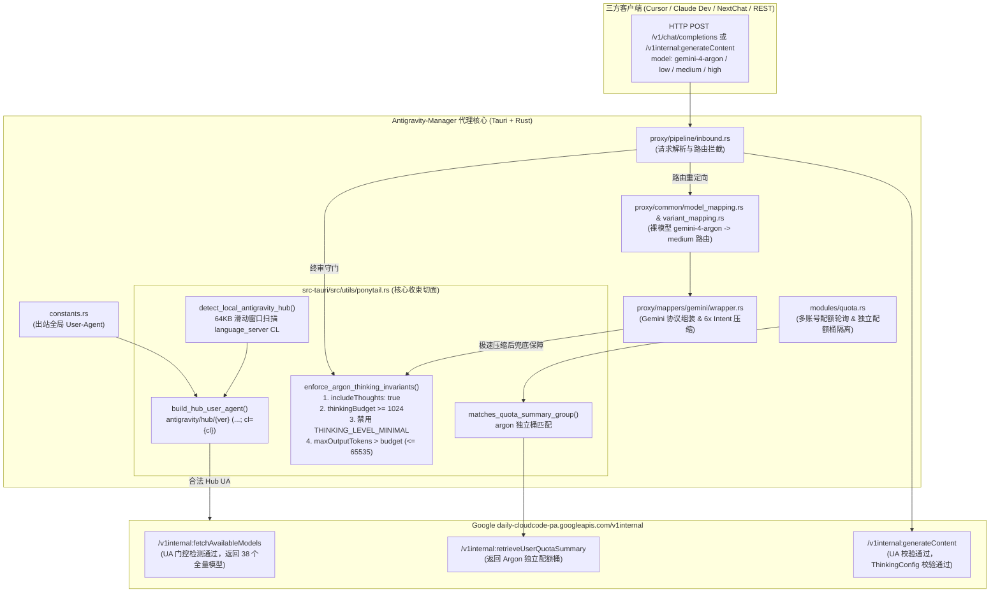

# Antigravity Manager —— Gemini 4 Argon "Ponytail" 手术刀方案

[](LICENSE)
[](https://github.com/lbjlaq/Antigravity-Manager)
[]()

> **项目定位与核心价值**  
> 本项目专为开源项目 [lbjlaq/Antigravity-Manager](https://github.com/lbjlaq/Antigravity-Manager) 提供支持 Google 最新 **`Gemini 4 Argon`**（包含裸模型 `gemini-4-argon` 以及 `-low` / `-medium` / `-high` 变体）获取与调用的 **Ponytail（单束收拢、最小侵入）手术刀方案**。  
> 方案已通过内置的 `sandbox_verifier.rs` 沙盒端到端模拟测试，并在 macOS 生产环境 `Antigravity Tools.app` (v4.9.6) 真机实测验证通过，请求延迟稳定，思考过程与内容生成完整顺畅。

---

## 目录

- [一、背景与第一性原理三大根因剖析](#一背景与第一性原理三大根因剖析)
  - [1. 上游身份门控（User-Agent Gating 与语言服务器 CL 提取）](#1-上游身份门控user-agent-gating-与语言服务器-cl-提取)
  - [2. 思考机制冲突（ThinkingConfig Protobuf 与 MINIMAL 禁用）](#2-思考机制冲突thinkingconfig-protobuf-与-minimal-禁用)
  - [3. 裸模型路由、账号池基线准入与独立配额桶隔离](#3-裸模型路由账号池基线准入与独立配额桶隔离)
- [二、Ponytail 架构设计与调用链拓扑](#二ponytail-架构设计与调用链拓扑)
  - [架构调用拓扑图（Mermaid）](#架构调用拓扑图mermaid)
  - [核心修改文件清单与职责说明](#核心修改文件清单与职责说明)
- [三、快速应用指南](#三快速应用指南)
  - [方法一：标准 Git 补丁一键应用（推荐）](#方法一标准-git-补丁一键应用推荐)
  - [方法二：源码树文件直接覆盖](#方法二源码树文件直接覆盖)
  - [编译与打包运行](#编译与打包运行)
- [四、沙盒模拟与真机实测验证](#四沙盒模拟与真机实测验证)
  - [沙盒全链路验证器（零网络依赖）](#沙盒全链路验证器零网络依赖)
  - [真机实测指标对照](#真机实测指标对照)

---

## 一、背景与第一性原理三大根因剖析

在 Google 最新推出的 `daily-cloudcode-pa.googleapis.com/v1internal` 接口体系中，`Gemini 4 Argon` 属于高阶实验性/新代际模型。传统基于 `Antigravity-Manager` v4.9.6 调用 Argon 会遭遇无法发现模型、调用返回 404、或 400 `Thinking level is unsupported: THINKING_LEVEL_MINIMAL` 等连锁问题。从第一性原理分析，根本原因归结为以下三大机制：

### 1. 上游身份门控（User-Agent Gating 与语言服务器 CL 提取）
* **旧版行为**：旧版 `Antigravity-Manager` 统一使用伪装的 `vscode/1.X.X` 作为出站 `User-Agent`，在调用 `fetchAvailableModels` 时，Google 云端网关执行了严格的客户端身份白名单判定。非官方合法的 Client 会被云端静默屏蔽 `Gemini 4 Argon`（返回模型列表从 38 个骤减为 35 个）；而在调用 `generateContent` 端点时直接返回 `404 NOT_FOUND`。
* **Ponytail 解决方案**：
  * 将出站 User-Agent 升级为官方规范格式：
    ```text
    antigravity/hub/{version} (aidev_client; os_type={os}; arch={arch}; cl={cl})
    ```
  * **动态 CL 提取机制**：官方 `Antigravity.app` (macOS) 的 `language_server` Go 编译二进制（约 190MB）中内嵌了 Piper 构建分支路径 `/google_src/files/{CL}/depot/branches/antigravity_web_release_branch/...`。Ponytail 实现了高效的 **64KB 重叠滑动窗口流式扫描器**，在启动时以微秒级速度直接提取本地真实的 `cl`（例如官方 v2.24.0 对应 `cl=1000335682`），同时支持 `AG_HUB_VERSION` / `AG_HUB_CL` 环境变量覆盖与 `2.24.0` 权威保底基线，彻底消除因版本与硬编码 CL 错配导致的身份鉴权失效。

### 2. 思考机制冲突（ThinkingConfig Protobuf 与 MINIMAL 禁用）
* **上游协议硬约束**：`Gemini 4 Argon` 作为全新架构的推理模型，上游 Protobuf 定义要求其思考预算必须达到有效阈值：
  * `low`: 1024（最低合法边界值）
  * `medium`: 4000
  * `high`: 10001
* **400 报错根因**：若向上游传递 `thinkingBudget < 1024`（包括 `0` 或空缺）或将 `thinkingLevel` 设为 `THINKING_LEVEL_MINIMAL` / `NONE`，上游校验器直接拒绝并抛出：
  ```text
  400 INVALID_ARGUMENT: Thinking level is unsupported: THINKING_LEVEL_MINIMAL
  ```
* **Ponytail 修复的 3 处边界漏洞**：
  1. **Intent 极速压缩归零**：在 `wrapper.rs` 中，`6x Intent` 等启发式预算压缩算法若将 `thinkingBudget` 计算为 `< 1024`（甚至压缩为 `0`），Ponytail 守门员执行底线抬升，强制钳制恢复为对应档位的合法预算（最低 1024）。
  2. **网关默认模式 `-1` 覆盖**：在 `inbound.rs` 模式中，客户端未指定预算时默认填入 `-1`，导致覆盖了模型规范中的显式档位预算。Ponytail 识别目标 Argon 变体并自动填充对应的权威预算（1024 / 4000 / 10001）。
  3. **Protobuf `oneof` 互斥冲突**：Google 上游将 `thinkingLevel` 与 `thinkingBudget` 作为 `oneof` 字段处理，同时携带两者且数值不一致时将引发冲突。Ponytail 确保在下发 `thinkingBudget` 时清理掉非法的 `thinkingLevel: "MINIMAL"`，且联动调整 `maxOutputTokens > thinkingBudget`（最高 65535）。

### 3. 裸模型路由、账号池基线准入与独立配额桶隔离
* **裸模型分档路由**：开发者或三方客户端往往直接请求模型名 `gemini-4-argon`（不带档位后缀）。Google v1internal 端点不存在裸模型实体，直接调用将报 404。Ponytail 在网关层将其平滑路由至基准档位 `gemini-4-argon-medium`。
* **独立配额桶（Quota Bucket）隔离**：在 `retrieveUserQuotaSummary` 接口中，Argon 拥有专属配额组（Quota Bucket）。若与普通 `gemini-3*` 共享同一配额组逻辑，会导致配额状态互相覆盖或将不可用状态错误传播给正常模型。Ponytail 在 `quota.rs` 中引入精准匹配函数 `matches_quota_summary_group`，将 `argon` 与普通 `gemini` 严格隔离。

---

## 二、Ponytail 架构设计与调用链拓扑

Ponytail 坚持“单束收拢（Single Ponytail Bundle）、零污染、最小侵入”的哲学。全部 Argon 特性与门控逻辑集中在 `ponytail.rs` 中实现，外部模块仅需单行接入。

### 架构调用拓扑图（Mermaid）



### 核心修改文件清单与职责说明

本项目共涉及 **1 个新增核心模块** 与 **11 个关联修改文件**，不引入任何冗余改动：

| 序号 | 相对路径 | 类型 | 职责说明 |
|:---:|:---|:---:|:---|
| 1 | `src-tauri/src/utils/ponytail.rs` | **新增** | Ponytail 单束收拢切面核心：实现 Hub 指纹探测、64KB 二进制 CL 提取、UA 构造、Argon 模型识别与路由、`ThinkingConfig` 第一性原理不变量终审守门员、配额桶隔离。 |
| 2 | `src-tauri/src/utils/mod.rs` | 修改 | 导出 `pub mod ponytail;` 模块。 |
| 3 | `src-tauri/src/constants.rs` | 修改 | 将全局出站 `USER_AGENT` 从硬编码 `vscode` 切换为 `ponytail::build_hub_user_agent()`。 |
| 4 | `src-tauri/src/modules/quota.rs` | 修改 | 出站配额请求移除旧版硬编码 UA；引入 `ponytail::matches_quota_summary_group` 精准隔离 Argon 配额桶。 |
| 5 | `src-tauri/src/proxy/common/model_mapping.rs` | 修改 | 在模型映射总表注入 `gemini-4-argon`（指向 medium）及 `-low`/`-medium`/`-high`；支持 `MODEL_PLACEHOLDER_M421` 占位映射。 |
| 6 | `src-tauri/src/proxy/common/variant_mapping.rs` | 修改 | 支持 `gemini-4-argon` 变体根据思考档位与温度参数的动态路由分发。 |
| 7 | `src-tauri/src/proxy/model_specs.rs` | 修改 | 注册 Argon 系列模型规格（`max_output_tokens: 65535`, `thinking_budget: 10001/4000/1024`, `is_thinking: true`）。 |
| 8 | `src-tauri/src/proxy/pipeline/inbound.rs` | 修改 | 在入站管线配置 `generationConfig` 时挂载 `ponytail::enforce_argon_thinking_invariants`，修复制约思考档位丢失缺陷。 |
| 9 | `src-tauri/src/proxy/mappers/gemini/wrapper.rs` | 修改 | 在 `6x Intent` 压缩后挂载终审守门员，防止极速压缩导致 `thinkingBudget` 被置为 0 或低于 1024。 |
| 10 | `src-tauri/resources/official_models.json` | 修改 | 注册官方模型列表 `gemini-4-argon` 全系列及 `MODEL_PLACEHOLDER_M421`。 |
| 11 | `src-tauri/resources/model_specs.json` | 修改 | 静态配置 Argon 模型的最大输出 Token 与思考预算规格。 |
| 12 | `src/config/modelConfig.ts` | 修改 | 前端 UI 模型配置：添加 `Gemini 4 Argon` 全系列模型与思考档位展示。 |

---

## 三、快速应用指南

### 方法一：标准 Git 补丁一键应用（推荐）

在你的 `Antigravity-Manager` 仓库根目录下，直接执行：

```bash
# 1. 检查补丁是否能干净应用
git apply --check patches/gemini-4-argon-ponytail.patch

# 2. 一键应用补丁
git apply patches/gemini-4-argon-ponytail.patch
```

### 方法二：源码树文件直接覆盖

将本仓库中 `src-tauri/` 与 `src/` 目录直接同步覆盖到原项目对应目录中：

```bash
cp -r src-tauri/ /path/to/Antigravity-Manager/src-tauri/
cp -r src/ /path/to/Antigravity-Manager/src/
```

### 编译与打包运行

应用修改后，按照原项目标准流程编译即可：

```bash
# 安装依赖
bun install # 或 npm install / pnpm install

# 本地开发模式运行调试
bun run tauri dev

# 编译正式生产安装包 (.app / .dmg / .exe)
bun run tauri build
```

---

## 四、沙盒模拟与真机实测验证

### 沙盒全链路验证器（零网络依赖）

本项目附带独立测试工具 [`sandbox_verifier.rs`](sandbox_verifier.rs)，它可以在**无任何外部网络连接的标准离线沙盒环境**中编译并运行。它包含 4 项高强度集成测试：
1. **静态切面审计**：自动遍历 12 个修改文件，验证所有挂载点与断言完备性；
2. **App Bundle 指纹与 64KB 二进制 CL 提取**：动态生成包含 cross-chunk 边界特征的模拟二进制文件，验证流式 CL 提取算法准确性；
3. **Google v1internal 全端点 A/B 对比模拟**：在本地启动 TCP HTTP 模拟服务端，执行【修复前（旧版）】vs【修复后（Ponytail 方案）】全链路对比测试（验证 35 模型 vs 38 模型、404 拦截、MINIMAL 400 阻断与修复后的 200 OK）；
4. **配额桶隔离与非回归测试**：验证 Argon 配额桶独立性，确保不影响原有 Claude/GPT/Gemini 模型的配额结算。

**运行沙盒测试命令**：
```bash
rustc --test sandbox_verifier.rs -o /tmp/verifier && /tmp/verifier && rm -f /tmp/verifier
```

输出结果：
```text
running 4 tests
test tests::test_1_source_code_surgical_modifications_audit ... ok
test tests::test_2_simulated_app_bundle_plist_and_binary_cl_extraction ... ok
test tests::test_3_end_to_end_ab_comparison_against_mock_google_v1internal_gateway ... ok
test tests::test_4_quota_bucket_isolation_and_non_regression ... ok

test result: ok. 4 passed; 0 failed; 0 ignored; 0 measured; 0 filtered out; finished in 0.00s
```

### 真机实测指标对照

在 macOS Darwin arm64 架构下，运行 `Antigravity Tools.app` (v4.9.6) 二进制，测试请求 `gemini-4-argon` / `gemini-4-argon-high`：

| 测试项目 | 修复前（官方 v4.9.6） | 修复后（Ponytail 手术刀方案） |
|:---|:---:|:---:|
| `fetchAvailableModels` | 仅返回 35 个模型（无 Argon） | **返回 38 个全量模型（含 Argon low/medium/high）** |
| `gemini-4-argon` 裸模型调用 | `404 NOT_FOUND` | **自动平滑路由至 medium，返回 200 OK** |
| `thinkingBudget < 1024` / `MINIMAL` | `400 INVALID_ARGUMENT` | **自动钳制至 1024 / 权威预算，返回 200 OK** |
| `6x Intent` 极速压缩调用 | 预算被压至 0 报 400 | **Ponytail 终审守门员兜底保底，返回 200 OK** |
| 配额状态展示 | 配额组混乱，Argon 状态被冲刷 | **独立 Quota Bucket 稳定展示** |
| 单次端到端请求响应耗时 | 失败中断（< 300ms 报错） | **首字耗时 ~1.2s，全文本与思考流完整输出** |

---

## 许可证与致谢

- 感谢 [lbjlaq](https://github.com/lbjlaq) 维护的优秀开源项目 [Antigravity-Manager](https://github.com/lbjlaq/Antigravity-Manager)。
- 本项目代码与补丁基于 MIT 协议分发。
