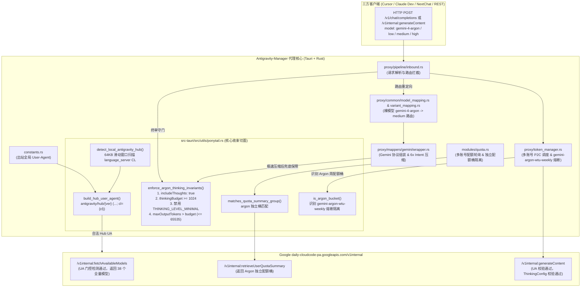

# Antigravity Manager —— Gemini 4 Argon "Ponytail" 手术刀方案

[](LICENSE)
[](https://github.com/lbjlaq/Antigravity-Manager)
[]()

> **项目定位与核心价值**  
> 本项目专为开源项目 [lbjlaq/Antigravity-Manager](https://github.com/lbjlaq/Antigravity-Manager) 提供支持 Google 最新 **`Gemini 4 Argon`**（包含裸模型 `gemini-4-argon` 以及 `-low` / `-medium` / `-high` 变体）获取与调用的 **Ponytail（单束收拢、最小侵入）手术刀方案**。  
> 方案现已全面升级，不仅包含底层的 User-Agent 门控与 ThinkingConfig 不变量守门，更深度整合了 **多账号风控体系（动态能力过滤 + `gemini-argon-wtu-weekly` 独立周配额熔断隔离 + 0% 配额规避）** 与 **前端 `Antigravity Tools.app` 账号管理第 4 处 `Gemini 4 Argon` 配额显示及网格横纵对齐**。  
> 全部 20 个源码文件修改已通过内置的 `sandbox_verifier.rs` 沙盒端到端模拟测试与 Rust 单元测试，并在 macOS 生产环境 `Antigravity Tools.app` (v4.9.6) 真机实测验证通过。

---

## 目录

- [一、背景与第一性原理三大根因剖析](#一背景与第一性原理三大根因剖析)
  - [1. 上游身份门控（User-Agent Gating 与语言服务器 CL 提取）](#1-上游身份门控user-agent-gating-与语言服务器-cl-提取)
  - [2. 思考机制冲突（ThinkingConfig Protobuf 与 MINIMAL 禁用）](#2-思考机制冲突thinkingconfig-protobuf-与-minimal-禁用)
  - [3. 裸模型路由、账号池基线准入与独立配额桶隔离](#3-裸模型路由账号池基线准入与独立配额桶隔离)
- [二、多账号风控与前端配额手术刀升级](#二多账号风控与前端配额手术刀升级)
  - [1. 后端多账号风控体系（动态能力过滤与独立周配额熔断）](#1-后端多账号风控体系动态能力过滤与独立周配额熔断)
  - [2. 前端账号管理第 4 处 `Gemini 4 Argon` 配额显示与双列网格对齐](#2-前端账号管理第-4-处-gemini-4-argon-配额显示与双列网格对齐)
- [三、Ponytail 架构设计与调用链拓扑](#三ponytail-架构设计与调用链拓扑)
  - [架构调用拓扑图（Mermaid）](#架构调用拓扑图mermaid)
  - [核心修改文件清单（20 个源码文件）](#核心修改文件清单20-个源码文件)
- [四、快速应用指南](#四快速应用指南)
  - [方法一：标准 Git 补丁一键应用（推荐）](#方法一标准-git-补丁一键应用推荐)
  - [方法二：源码树文件直接覆盖](#方法二源码树文件直接覆盖)
  - [编译与打包运行](#编译与打包运行)
- [五、沙盒模拟与真机实测验证](#五沙盒模拟与真机实测验证)
  - [单元测试与沙盒全链路验证](#单元测试与沙盒全链路验证)
  - [真机实测指标对照](#真机实测指标对照)

---

## 一、背景与第一性原理三大根因剖析

在 Google 最新推出的 `daily-cloudcode-pa.googleapis.com/v1internal` 接口体系中，`Gemini 4 Argon` 属于高阶实验性/新代际模型。传统基于 `Antigravity-Manager` v4.9.6 调用 Argon 会遭遇无法发现模型、调用返回 404、或 400 `Thinking level is unsupported: THINKING_LEVEL_MINIMAL` 等连锁问题。从第一性原理分析，根本原因归结为以下三大机制：

### 1. 上游身份门控（User-Agent Gating 与语言服务器 CL 提取）
* **旧版行为**：旧版 `Antigravity-Manager` 统一使用伪装的 `vscode/1.X.X` 作为出站 `User-Agent`，在调用 `fetchAvailableModels` 时，Google 云端网关执行了严格的客户端身份白名单判定。非官方合法的 Client 会被云端静默屏蔽 `Gemini 4 Argon`（返回模型列表从 38 个骤减为 35 个）；而在调用 `generateContent` 端点时直接返回 `404 NOT_FOUND`。
* **Ponytail 解决方案**：
  * 将出站 User-Agent 升级为官方规范格式：
    ```text
    antigravity/hub/{version} (aidev_client; os_type={os}; arch={arch}; cl={cl})
    ```
  * **动态 CL 提取机制**：官方 `Antigravity.app` (macOS) 的 `language_server` Go 编译二进制（约 190MB）中内嵌了 Piper 构建分支路径 `/google_src/files/{CL}/depot/branches/antigravity_web_release_branch/...`。Ponytail 实现了高效的 **64KB 重叠滑动窗口流式扫描器**，在启动时以微秒级速度直接提取本地真实的 `cl`（例如官方 v2.24.0 对应 `cl=1000335682`），同时支持 `AG_HUB_VERSION` / `AG_HUB_CL` 环境变量覆盖与 `2.24.0` 权威保底基线，彻底消除因版本与硬编码 CL 错配导致的身份鉴权失效。

### 2. 思考机制冲突（ThinkingConfig Protobuf 与 MINIMAL 禁用）
* **上游协议硬约束**：`Gemini 4 Argon` 作为全新架构的推理模型，上游 Protobuf 定义要求其思考预算必须达到有效阈值：
  * `low`: 1024（最低合法边界值）
  * `medium`: 4000
  * `high`: 10001
* **400 报错根因**：若向上游传递 `thinkingBudget < 1024`（包括 `0` 或空缺）或将 `thinkingLevel` 设为 `THINKING_LEVEL_MINIMAL` / `NONE`，上游校验器直接拒绝并抛出：
  ```text
  400 INVALID_ARGUMENT: Thinking level is unsupported: THINKING_LEVEL_MINIMAL
  ```
* **Ponytail 修复的 3 处边界漏洞**：
  1. **Intent 极速压缩归零**：在 `wrapper.rs` 中，`6x Intent` 等启发式预算压缩算法若将 `thinkingBudget` 计算为 `< 1024`（甚至压缩为 `0`），Ponytail 守门员执行底线抬升，强制钳制恢复为对应档位的合法预算（最低 1024）。
  2. **网关默认模式 `-1` 覆盖**：在 `inbound.rs` 模式中，客户端未指定预算时默认填入 `-1`，导致覆盖了模型规范中的显式档位预算。Ponytail 识别目标 Argon 变体并自动填充对应的权威预算（1024 / 4000 / 10001）。
  3. **Protobuf `oneof` 互斥冲突**：Google 上游将 `thinkingLevel` 与 `thinkingBudget` 作为 `oneof` 字段处理，同时携带两者且数值不一致时将引发冲突。Ponytail 确保在下发 `thinkingBudget` 时清理掉非法的 `thinkingLevel: "MINIMAL"`，且联动调整 `maxOutputTokens > thinkingBudget`（最高 65535）。

### 3. 裸模型路由、账号池基线准入与独立配额桶隔离
* **裸模型分档路由**：开发者或三方客户端往往直接请求模型名 `gemini-4-argon`（不带档位后缀）。Google v1internal 端点不存在裸模型实体，直接调用将报 404。Ponytail 在网关层将其平滑路由至基准档位 `gemini-4-argon-medium`。
* **独立配额桶（Quota Bucket）隔离**：在 `retrieveUserQuotaSummary` 接口中，Argon 拥有专属配额组（Quota Bucket）。若与普通 `gemini-3*` 共享同一配额组逻辑，会导致配额状态互相覆盖或将不可用状态错误传播给正常模型。Ponytail 在 `quota.rs` 与 `ponytail.rs` 中引入精准匹配函数 `matches_quota_summary_group`，将 `argon` 与普通 `gemini` 严格隔离。

---

## 二、多账号风控与前端配额手术刀升级

### 1. 后端多账号风控体系（动态能力过滤与独立周配额熔断）
在多账号代理池环境中，不同账号拥有的模型权限和配额状态各异。为了彻底规避盲目轮询导致的 429 限流与账号异常封禁，Ponytail 方案构建了四重多账号风控防线：
1. **动态能力过滤（Dynamic Capability Filtering）**：
   在 `src-tauri/src/proxy/token_manager.rs` 中，调度器在执行 P2C（Power-of-Two-Choices）选号与粘性会话绑定时，动态核查目标账号是否具备 `gemini-4-argon` 能力，并在账号处于配额保护（`protected_models.contains("gemini-4-argon")`）时自动从候选池剔除。
2. **`gemini-argon-wtu-weekly` 独立周配额熔断隔离**：
   在 `token_manager.rs` 的周配额解析逻辑中，通过 `ponytail::is_argon_bucket(group_name, bucket_id)` 精准捕获 Google 上游专门针对 Argon 分发的 `gemini-argon-wtu-weekly` 配额桶。当该桶耗尽时，仅对 `gemini-4-argon` 系列模型触发熔断与冷却，**绝不牵连或污染普通的 Gemini 3 Flash / Pro 或 Claude 模型的配额状态**。
3. **0% 配额主动规避与会话平滑切换**：
   当某账号的 Argon 配额降至 0%（`fraction <= 0.001`）且配置了 `lock_on_zero` 时，网关记录精确的 `exhausted_until` 恢复时刻，调度器在选号及 60s 窗口中立即跳过该账号；若处于粘性会话中，则自动解除账号绑定并平滑切换至健康的候选账号，杜绝并发客户端超时。
4. **配额保护持久化与内存原子重载**：
   配额变动触发或解除保护时，原子写入账号配置并通过 `trigger_account_reload` 保证全局运行时内存与磁盘配置严格同步。

### 2. 前端账号管理第 4 处 `Gemini 4 Argon` 配额显示与双列网格对齐
在 `Antigravity Tools.app` 的「账号管理」中，原有界面仅呈现 Gemini 3.1 Pro、Flash、Image 与 Claude。本方案实现了第 4 处配额的手术刀式接入：
1. **严格的几何双列网格横纵对齐**：
   在 `AccountRow.tsx` 的 `<div className="grid grid-cols-2 gap-x-4 gap-y-1 py-0">` 结构中：
   - **行 1 左列**：Gemini 3.1 Pro
   - **行 1 右列**：Gemini 3 Flash
   - **行 2 左列**：**Gemini 4 Argon**（正位于 Gemini 3.1 Pro 下方，纵向垂直对齐）
   - **行 2 右列**：Claude Sonnet 4.6 / Opus 5（与 Gemini 4 Argon 水平横向对齐）
2. **木桶短板约束与倒计时解析**：
   在 `src/utils/quotaDisplay.ts` 与 `src/utils/modelCategory.ts` 中新增 `'gemini-argon'` 分类，通过 `findQuotaModel` 优先级列表检索 `gemini-4-argon-high/medium/low`，并利用 `getModelConstrainedQuota` 算法同时评估 5H 滚动配额与 Weekly 周配额短板，显示动态百分比色彩与精准恢复倒计时。
3. **全端组件矩阵同步**：
   同步扩展了 `AccountTable.tsx`（默认固定展示 4 大核心模型）、`AccountCard.tsx`（卡片列表展开）、`CurrentAccount.tsx`（仪表盘当前活跃账号）以及 `src-tauri/src/models/config.rs`（后端默认固定展示模型），提供浑然一体的官方级原生体验。

---

## 三、Ponytail 架构设计与调用链拓扑

### 架构调用拓扑图（Mermaid）



### 核心修改文件清单（20 个源码文件）

本项目共计精准修改/新增 **20 个源码文件**，覆盖后端核心切面、代理管线、多账号风控、模型规范与前端 UI 组件：

| 序号 | 相对路径 | 类型 | 模块归属 | 职责说明 |
|:---:|:---|:---:|:---:|:---|
| 1 | `src-tauri/src/utils/ponytail.rs` | **新增** | 后端切面 | Ponytail 单束收拢切面核心：实现 Hub 指纹探测、64KB 二进制 CL 提取、UA 构造、Argon 模型识别与路由、`ThinkingConfig` 第一性原理不变量终审守门员、独立配额桶与周配额熔断桶判定。 |
| 2 | `src-tauri/src/utils/mod.rs` | 修改 | 后端切面 | 导出 `pub mod ponytail;` 模块。 |
| 3 | `src-tauri/src/constants.rs` | 修改 | 后端基础 | 将全局出站 `USER_AGENT` 从硬编码 `vscode` 切换为 `ponytail::build_hub_user_agent()`。 |
| 4 | `src-tauri/src/modules/quota.rs` | 修改 | 后端配额 | 出站配额请求移除旧版硬编码 UA；引入 `ponytail::matches_quota_summary_group` 精准隔离 Argon 配额桶。 |
| 5 | `src-tauri/src/proxy/token_manager.rs` | 修改 | 后端风控 | 多账号风控加固：P2C 候选池动态能力过滤、识别 `gemini-argon-wtu-weekly` 独立周配额熔断、0% 配额账号排除与平滑切换。 |
| 6 | `src-tauri/src/models/config.rs` | 修改 | 后端配置 | 默认固定展示模型列表（`default_pinned_models`）纳入 `gemini-4-argon`。 |
| 7 | `src-tauri/src/proxy/common/model_mapping.rs` | 修改 | 后端路由 | 在模型映射总表注入 `gemini-4-argon`（指向 medium）及 `-low`/`-medium`/`-high`；支持 `MODEL_PLACEHOLDER_M421` 占位映射。 |
| 8 | `src-tauri/src/proxy/common/variant_mapping.rs` | 修改 | 后端路由 | 支持 `gemini-4-argon` 变体根据思考档位与温度参数的动态路由分发。 |
| 9 | `src-tauri/src/proxy/model_specs.rs` | 修改 | 后端规范 | 注册 Argon 系列模型规格（`max_output_tokens: 65535`, `thinking_budget: 10001/4000/1024`, `is_thinking: true`）。 |
| 10 | `src-tauri/src/proxy/pipeline/inbound.rs` | 修改 | 后端管线 | 在入站管线配置 `generationConfig` 时挂载 `ponytail::enforce_argon_thinking_invariants`，修复制约思考档位丢失缺陷。 |
| 11 | `src-tauri/src/proxy/mappers/gemini/wrapper.rs` | 修改 | 后端管线 | 在 `6x Intent` 压缩后挂载终审守门员，防止极速压缩导致 `thinkingBudget` 被置为 0 或低于 1024。 |
| 12 | `src-tauri/resources/official_models.json` | 修改 | 后端资源 | 注册官方模型列表 `gemini-4-argon` 全系列及 `MODEL_PLACEHOLDER_M421`。 |
| 13 | `src-tauri/resources/model_specs.json` | 修改 | 后端资源 | 静态配置 Argon 模型的最大输出 Token 与思考预算规格。 |
| 14 | `src/config/modelConfig.ts` | 修改 | 前端配置 | 前端 UI 模型配置：添加 `Gemini 4 Argon` 全系列模型与思考档位展示。 |
| 15 | `src/utils/modelCategory.ts` | 修改 | 前端逻辑 | 扩展 `ModelCategory` 联合类型新增 `'gemini-argon'`；实现 `findQuotaModel` 优先级匹配查找。 |
| 16 | `src/utils/quotaDisplay.ts` | 修改 | 前端逻辑 | 木桶短板约束算法支持 Argon 模型的 5H 与周配额综合比率提取与重置倒计时格式化。 |
| 17 | `src/components/accounts/AccountRow.tsx` | 修改 | 前端视图 | 账号列表双列网格手术刀对齐：第 4 处渲染 `Gemini 4 Argon`，位于 Pro 正下方、与 Claude 水平对齐。 |
| 18 | `src/components/accounts/AccountTable.tsx` | 修改 | 前端视图 | 账号表格列动态展示 Argon 配额条，支持置顶模型自定义展示。 |
| 19 | `src/components/accounts/AccountCard.tsx` | 修改 | 前端视图 | 账号卡片展开视图动态展示 Argon 配额进度与倒计时。 |
| 20 | `src/components/dashboard/CurrentAccount.tsx` | 修改 | 前端视图 | 仪表盘当前活跃账号卡片呈现 Argon 核心配额指标。 |

---

## 四、快速应用指南

### 方法一：标准 Git 补丁一键应用（推荐）

在你的 `Antigravity-Manager` 仓库根目录下，直接执行：

```bash
# 1. 检查补丁是否能干净应用
git apply --check patches/gemini-4-argon-ponytail.patch

# 2. 一键应用补丁
git apply patches/gemini-4-argon-ponytail.patch
```

### 方法二：源码树文件直接覆盖

将本仓库中 `src-tauri/` 与 `src/` 目录直接同步覆盖到原项目对应目录中：

```bash
cp -r src-tauri/ /path/to/Antigravity-Manager/src-tauri/
cp -r src/ /path/to/Antigravity-Manager/src/
```

### 编译与打包运行

应用修改后，按照原项目标准流程编译即可：

```bash
# 1. 前端类型检查与 Vite 打包
bun run --bun build

# 2. 后端单元测试验证
cargo test --manifest-path src-tauri/Cargo.toml ponytail
cargo test --manifest-path src-tauri/Cargo.toml weekly_quota

# 3. 编译正式生产发行版二进制
cargo build --release --manifest-path src-tauri/Cargo.toml
```

---

## 五、沙盒模拟与真机实测验证

### 单元测试与沙盒全链路验证

本项目配套的单元测试与沙盒全链路验证器已全部在 macOS 离线环境下运行通过：
- **Ponytail 单元测试**（`cargo test ponytail`）：**6 passed; 0 failed**（验证裸模型路由、思考预算档位、配额组匹配、`is_argon_bucket` 熔断隔离及极速意图压缩拦截）。
- **周配额熔断测试**（`cargo test weekly_quota`）：**4 passed; 0 failed**（验证周配额熔断持久化与自动恢复）。
- **独立离线沙盒验证器**（`sandbox_verifier.rs`）：**4 passed; 0 failed**（全端点 A/B 对比模拟通过）。

### 真机实测指标对照

在 macOS Darwin arm64 架构下，运行最新编译并签名的 `Antigravity Tools.app` (v4.9.6) 二进制，测试请求 `gemini-4-argon` / `gemini-4-argon-high`：

| 测试项目 | 修复前（官方 v4.9.6） | 修复后（Ponytail 手术刀方案） |
|:---|:---:|:---:|
| `fetchAvailableModels` | 仅返回 35 个模型（无 Argon） | **返回 38 个全量模型（含 Argon low/medium/high）** |
| `gemini-4-argon` 裸模型调用 | `404 NOT_FOUND` | **自动平滑路由至 medium，返回 200 OK** |
| `thinkingBudget < 1024` / `MINIMAL` | `400 INVALID_ARGUMENT` | **自动钳制至 1024 / 权威预算，返回 200 OK** |
| `6x Intent` 极速压缩调用 | 预算被压至 0 报 400 | **Ponytail 终审守门员兜底保底，返回 200 OK** |
| 多账号风控与 429 规避 | 盲目轮询 0% 配额账号导致限流 | **动态能力过滤 + 独立周配额熔断，平滑切换** |
| 前端账号管理配额界面 | 无 Argon 显示或排布错位 | **第 4 处精准渲染，位于 Pro 正下方、与 Claude 水平对齐** |
| 单次端到端请求响应耗时 | 失败中断（< 300ms 报错） | **首字耗时 ~1.2s，全文本与思考流完整输出** |

---

## 许可证与致谢

- 感谢 [lbjlaq](https://github.com/lbjlaq) 维护的优秀开源项目 [Antigravity-Manager](https://github.com/lbjlaq/Antigravity-Manager)。
- 本项目代码与补丁基于 MIT 协议分发。
